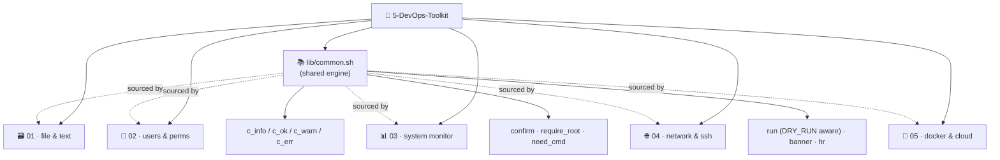

<div align="center">

# 🧰 5-DevOps-Toolkit

### `5 folders` · `25 single-purpose tools` · `1 shared engine` · `249 tests` · `6 green CI checks`

**Turning a raw Linux command cheat-sheet into a working, guarded DevOps toolkit.**
*הופך רשימת פקודות לינוקס גולמית לערכת כלים אמיתית, מסודרת ומוגנת.*

<br/>

[](https://github.com/www8351/5-DevOps-Toolkit/actions/workflows/shellcheck.yml)
[](https://github.com/www8351/5-DevOps-Toolkit/actions/workflows/python.yml)
[](https://github.com/www8351/5-DevOps-Toolkit/releases)
<br/>


<br/>


</div>

---

## 🌍 What is this? · מה זה?

<table>
<tr>
<td width="50%" valign="top">

### 🇬🇧 English

This repository is a **portfolio of small, sharp shell scripts** built from a hand-written list of Linux,
networking, Docker and AWS commands.

Instead of one giant script, the commands are composed into **25 focused tools** spread across **5 themed
folders**. Every tool does *one* thing well, sources a **shared engine** (`lib/common.sh`), and ships with
help text, dependency checks and safety guards.

The point isn't the commands themselves. It's the **assembly**: how primitives like `find`, `awk`, `du`,
`docker` and `nmap` are wired into reliable, reusable tools.

</td>
<td width="50%" valign="top">

<div dir="rtl">

### 🇮🇱 עברית

המאגר הזה הוא **תיק עבודות של סקריפטים קטנים וחדים** שנבנו מתוך רשימת פקודות לינוקס, רשת, Docker ו-AWS
שנכתבה ביד.

במקום סקריפט ענק אחד, הפקודות מורכבות ל-**25 כלים ממוקדים** הפרוסים על פני **5 תיקיות נושאיות**. כל כלי
עושה *דבר אחד* טוב, טוען **מנוע משותף** (`lib/common.sh`), ומגיע עם מסך עזרה, בדיקות תלויות ומנגנוני
הגנה.

העיקר הוא לא הפקודות עצמן אלא **ההרכבה**: איך אבני בניין כמו `find`, `awk`, `du`, `docker` ו-`nmap`
מחוברות לכלים אמינים שאפשר לעשות בהם שימוש חוזר.

</div>

</td>
</tr>
</table>

---

## 🗂️ The 5 Modules

| # | Folder | Focus | Scripts | Key commands |
|:-:|--------|-------|:-------:|--------------|
| 🗃️ **01** | [`01-file-text-toolkit`](01-file-text-toolkit/) | files & text plumbing | 5 | `du` `grep` `awk` `find` `tar` |
| 👤 **02** | [`02-user-permissions`](02-user-permissions/) | users, groups & permissions | 5 | `useradd` `chmod` `chown` `usermod` |
| 📊 **03** | [`03-system-monitor`](03-system-monitor/) | system & hardware | 5 | `lscpu` `df` `free` `ps` `swapon` |
| 🌐 **04** | [`04-network-ssh`](04-network-ssh/) | networking & SSH | 5 | `ip` `ss` `nmap` `curl` `ssh-keygen` |
| 🐳 **05** | [`05-docker-devops`](05-docker-devops/) | Docker, packages & cloud | 5 | `docker` `apt` `boto3` |

---

## 🧬 Architecture



Every script `source`s **`lib/common.sh`**, a single shared engine that provides coloured logging,
`confirm` prompts, `require_root` / `need_cmd` guards and a `run` wrapper that honours `DRY_RUN=1`. One
library, 25 consumers: **DRY by design**, not copy-paste.

---

## 🚀 Quick start

```bash
# 1. clone
git clone https://github.com/www8351/5-DevOps-Toolkit.git
cd 5-DevOps-Toolkit

# 2. every script self-documents (scripts ship executable, no chmod needed)
./01-file-text-toolkit/dirsnap.sh --help

# 3. run something harmless
./01-file-text-toolkit/dirsnap.sh -n 5 .
./03-system-monitor/sysinfo.sh
./04-network-ssh/httpcheck.sh https://github.com https://example.com

# 4. preview a root tool as a normal user, WITHOUT touching the system
DRY_RUN=1 ./03-system-monitor/mkswap.sh -s 1G -f /tmp/demo.swap
```

> 🪟 **Windows users:** the commands target **Linux**. Run the read-only scripts in **Git Bash**, and the
> system/root scripts inside **WSL** or a Linux VM.

---

## 🛡️ Safety model

Every script follows the same defensive contract:

- `set -euo pipefail`: fail fast, fail loud.
- **`-h` / `--help`** on every tool, even when the tool's own dependencies are missing.
- **`need_cmd`** aborts early if a required binary is missing.
- **`require_root`** refuses to run privileged tools as a normal user, except for a `DRY_RUN=1` preview.
- **`confirm`** asks before any destructive action; skip it in CI with `--yes` (or `ASSUME_YES=1`).
  Answering no exits 1 and changes nothing.
- **`--dry-run`** (or `DRY_RUN=1`) prints what *would* happen instead of doing it. The flag survives
  `sudo`; the variable only does when written after it (`sudo DRY_RUN=1 ./tool.sh`).
- Health checks (`diskwatch.sh`, `memwatch.sh --warn`, `httpcheck.sh`, `pingsweep.sh`) exit 1 on a
  problem, so cron or CI can alert on them.

The Python tools follow the same rules: `ssh_toolkit net` changes nothing without `--apply` and asks
first, and `ec2-deploy.py` asks before a billed launch. See [`SECURITY.md`](SECURITY.md) for safe use
and how to report a problem.

> One file is exempt from the help contract on purpose: `04-network-ssh/setup.sh`, the venv
> bootstrapper for `ssh_toolkit`, which forwards every argument (help included) to the Python
> package. The bats contract tests skip exactly that file and enforce the rules on everything else.

---

## ⌨️ Command-line conventions

Every tool speaks the same command-line language, so learning one teaches the rest.

| Flag | Means the same thing in every tool |
|------|------------------------------------|
| `-h`, `--help` | help, accepted anywhere on the line |
| `-n` | how many rows to show (`--top`, or `--limit` / `--lines` where nothing is ranked) |
| `-f`, `--file` | a file to read or write |
| `-p`, `--port(s)` | a port or port list |
| `-t`, `--timeout` | a timeout in seconds |
| `-s`, `--size` | a size |
| `-w`, `--warn` | an alert threshold in percent |
| `-a`, `--all` | include everything |
| `-u`, `--user` | a user |
| `--dry-run`, `--yes` | preview only / skip prompts (same as `DRY_RUN=1` / `ASSUME_YES=1`) |
| `--json` | one JSON document on stdout (`diskwatch`, `memwatch`, `httpcheck`, `pingsweep`) |

| Exit code | Meaning |
|:---------:|---------|
| `0` | success (a report tool also exits 0 when its report lists findings) |
| `1` | a problem found by a check, a failed operation, or a declined prompt |
| `2` | a usage error: unknown flag, missing value, malformed number, wrong argument count |

Results go to stdout; warnings, errors and prompts go to stderr, so output can be piped safely.

```bash
./03-system-monitor/diskwatch.sh --warn 90 --json | python3 -m json.tool
./04-network-ssh/httpcheck.sh --json https://example.com | jq '.results[] | select(.ok | not)'
./04-network-ssh/pingsweep.sh --file hosts.txt || echo "a host is down"
```

Flags renamed in 1.1.0 still work and print a warning until 2.0.0; see [`CHANGELOG.md`](CHANGELOG.md).

---

## 🔬 Quality & CI

This isn't a script dump. It's an engineered repo. Every push and pull request runs **6 CI checks**;
a green tick means the whole toolkit is clean.

| Check | What it guarantees |
|-------|--------------------|
| **shellcheck + `bash -n`** | every `*.sh` is syntax-clean and shellcheck-clean (`-e SC1091`) |
| **bats** | 140 tests: `lib/common.sh`, the command-line contract for every tool (help anywhere and before dependency checks, exit 2 on bad usage, executable bit), behaviour tests on temp fixtures and stubbed commands, and the monitors' JSON |
| **pytest** (Python 3.10 + 3.14) | 109 tests over `ssh_toolkit` (config precedence, CLI flags, env toggles, input validation, remote command building, rollback) and `ec2-deploy.py` (launch prompt, env toggles) |
| **py_compile + ruff** | the Python compiles and passes ruff syntax + pyflakes rules (`E9,F`) |
| **makefile** | the `Makefile` parses and every target resolves (`make -n all`) |

**249 tests total, all VM-free.** Decisions and their rationale live in [`DECISIONS.md`](DECISIONS.md),
the current state in [`STATUS.md`](STATUS.md), a dated history in [`PROGRESS.md`](PROGRESS.md), and
release notes in [`CHANGELOG.md`](CHANGELOG.md).

---

## 🛠️ Development

Linters and tests mirror CI. Use **`make`** on Linux/WSL/macOS or **`tasks.ps1`** on Windows,
with identical target names. Install dev deps first: `pip install -r requirements-dev.txt`
(shell tests also need `bats` and `shellcheck`, e.g. `sudo apt install bats shellcheck`).

```bash
# Linux / WSL / macOS
make help          # list targets
make lint          # bash -n + shellcheck + ruff
make test          # bats + pytest
make all           # lint + test
```

```powershell
# Windows (PowerShell): tools absent on Windows are skipped with a warning
.\tasks.ps1 lint   # runs ruff; bash -n / shellcheck skipped on Windows (run in CI)
.\tasks.ps1 test   # runs pytest; bats skipped on Windows (runs in CI)
```

| Target | Runs |
|--------|------|
| `lint` | `bash -n`, `shellcheck` (`-e SC1091`), `ruff` (`E9,F`) |
| `test` | `bats tests/bats`, `pytest 04-network-ssh/tests 05-docker-devops/tests` |
| `all`  | `lint` then `test` |

---

## 🗺️ Roadmap

**Shipped**

- ✅ 25 guarded tools across 5 modules on one shared engine (`lib/common.sh`)
      (24 shell scripts plus one Python tool, `05/ec2-deploy.py`)
- ✅ `ssh_toolkit`: cross-platform (Windows / macOS / Linux) Python SSH automation
- ✅ Bilingual (HE / EN) documentation, published to GitHub
- ✅ **CI**: shellcheck, bats, pytest on Python 3.10 and 3.14, ruff and a Makefile check on every push and PR
- ✅ **249 tests** (140 bats + 109 pytest), all VM-free, including behaviour tests for the shell tools
- ✅ **One command-line contract** for all tools: shared flag letters, help anywhere, exit codes 0/1/2,
      `--dry-run`/`--yes` flags, and `--json` for the four monitors
- ✅ **Task runner**: `make` (Linux / WSL / macOS) and `tasks.ps1` (Windows), same targets
- ✅ Contributor docs ([`CONTRIBUTING.md`](CONTRIBUTING.md)), a security policy ([`SECURITY.md`](SECURITY.md))
      and a read-only demo tour ([`docs/demo.sh`](docs/demo.sh))
- ✅ Versioned releases: [`CHANGELOG.md`](CHANGELOG.md) plus a tag-driven release workflow; pinned CI
      actions and dev tools, kept current by Dependabot

**Planned**

- ⬜ Tag `v1.0.0`, which publishes the first GitHub release
- ⬜ Record the demo GIF ([`docs/DEMO.md`](docs/DEMO.md)) and embed it under the badges
- ⬜ Validate `ssh_toolkit` end-to-end against a live two-VM lab
- 💡 Add a coverage step and `bats` / `pytest` coverage badges

> Each hardening phase landed as small commits, so the `git log` reads like a progress timeline on
> purpose.

---

<details>
<summary><b>🧠 Skills demonstrated</b> (click to expand)</summary>

<br/>

- **Text processing pipelines**: `grep | awk | sort | uniq | cut | wc` composition.
- **Filesystem reasoning**: `find` by type/size/permission, `du` rollups, `tar` archiving.
- **Linux administration**: users, groups, ownership, mode bits, swap, services.
- **Observability**: CPU / memory / disk dashboards and threshold alerts with cron-friendly exit codes.
- **Networking**: interface & route inspection, host sweeps, endpoint health, port scanning, SSH keys.
- **Containers & cloud**: distro-agnostic package wrapper, Docker run/clean, Jenkins install, boto3 EC2.
- **Software engineering**: a shared library, consistent CLIs, guards, dry-run, and shellcheck hygiene.
- **Testing & CI**: bats + pytest (249 cases) with fixtures and stubbed commands, GitHub Actions on every push, a Makefile/PowerShell task runner.
- **Process discipline**: a maintained decision log, a changelog and status/progress files; each change lands as a small, reviewable commit.

</details>

<details>
<summary><b>🗺️ Command → script index</b> (click to expand)</summary>

<br/>

| Command | Where it lives |
|---------|----------------|
| `du` `sort` `head` `find` | `01/dirsnap.sh`, `01/bigfiles.sh` |
| `grep` `awk` `uniq` `cut` `wc` | `01/logtop.sh` |
| `wc` `head` `tail` | `01/txtstats.sh` |
| `tar` | `01/backup.sh` |
| `useradd` `passwd` | `02/newuser.sh` |
| `/etc/passwd` `/etc/group` `id` | `02/whohas.sh` |
| `chmod` `chown` | `02/permfix.sh` |
| `find -perm` (SUID/SGID) | `02/audit-perms.sh` |
| `usermod -aG` | `02/grant-sudo.sh` |
| `uname` `hostnamectl` `lscpu` `df` `free` | `03/sysinfo.sh` |
| `ps aux` | `03/topproc.sh` |
| `df` thresholds | `03/diskwatch.sh` |
| `free` `swapon` | `03/memwatch.sh` |
| `fallocate` `mkswap` `swapon` | `03/mkswap.sh` |
| `ip addr` `ip route` `ss` | `04/netinfo.sh` |
| `ping` | `04/pingsweep.sh` |
| `curl` `wget` | `04/httpcheck.sh` |
| `nmap` | `04/portscan.sh` |
| `ssh-keygen` `ssh-copy-id` | `04/sshkey.sh` |
| `apt` `yum` `dnf` | `05/pkg.sh` |
| `docker run/inspect` | `05/docker-run-web.sh` |
| `docker rm/rmi` | `05/docker-clean.sh` |
| `jenkins` `systemctl` `ufw` | `05/install-jenkins.sh` |
| `boto3` EC2 | `05/ec2-deploy.py` |

</details>

---

## 🌳 Repository layout

```
5-DevOps-Toolkit/
├── lib/
│   └── common.sh              # shared engine: logging, guards, run/confirm
├── 01-file-text-toolkit/      # dirsnap · logtop · bigfiles · txtstats · backup
├── 02-user-permissions/       # newuser · whohas · permfix · audit-perms · grant-sudo
├── 03-system-monitor/         # sysinfo · topproc · diskwatch · memwatch · mkswap
├── 04-network-ssh/            # netinfo · pingsweep · httpcheck · portscan · sshkey · ssh_toolkit/ (py) · tests/
├── 05-docker-devops/          # pkg · docker-run-web · docker-clean · install-jenkins · ec2-deploy.py · tests/
├── tests/bats/                # bats: lib/common.sh, the -h contract, tool behaviour per module
├── docs/                      # demo.sh (read-only tour) · DEMO.md (recording guide)
├── .github/                   # CI workflows (shellcheck · bats · makefile · python · release) · dependabot
├── Makefile  tasks.ps1        # dev task runner (Linux/WSL · Windows)
├── requirements-dev.txt       # pinned pytest + ruff
├── README.md  CONTRIBUTING.md # you are here · how to contribute
├── CHANGELOG.md  SECURITY.md  # release notes · security policy
├── STATUS.md  PROGRESS.md  DECISIONS.md   # current state · dated history · decision log
├── LICENSE                    # MIT
└── .gitignore  .editorconfig
```

---

<div align="center">

**Built by [@www8351](https://github.com/www8351)** · Licensed under [MIT](LICENSE)

<sub>Each script is small on purpose. The craft is in how they fit together.</sub>

</div>
